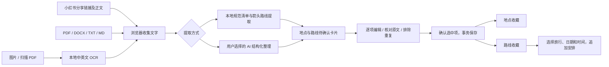

# 旅行资料导入与路线收藏

## 1. 使用入口与交互

旅游首页的 **导入旅行灵感**、地点收藏的 **导入**、路线收藏的 **从资料导入**，打开同一个导入弹窗。

底部/侧边导航增加 **路线收藏**。地点、路线、某一天的旅行安排是三种不同对象：收藏路线不需要出行日期，也不挤占地点分类。



### 第一步：添加资料

- 三个来源页签：小红书链接、文件与图片、粘贴文字。
- 小红书支持完整笔记链接、`xhslink.com` 分享链接及含链接的分享文字。
- **连接器未配置时**，页面说明需要粘贴正文或上传截图，链接随收藏保存；不会假装已读取远端笔记。
- **连接器配置后**，只有链接时可直接读取正文，再进入同样的提取流程。连接器必须返回已验证的登录状态。
- 可提供默认城市，资料没有城市时使用；仍不明确的城市留待确认。
- 图片显示缩略图，文件逐项显示读取状态和错误。读取失败时保留资料，修正或移除后重试。
- PDF 优先提取文本；扫描页转为有限尺寸画布后 OCR。DOCX 只读取正文 XML，不运行宏，不访问外部引用；嵌入图片请单独上传。旧 `.doc`、加密文档及 HEIC 暂不支持。

### 第二步：核对识别草稿

- 地点与路线分别以一行一张卡片展示，复选框决定是否保存，点卡片打开编辑。
- 提供原文对照（文件名、PDF 页码）、来源链接、原文短引。AI 返回的引用只有确实存在于输入中才保留。
- 同名同城的现有收藏、同批次重复项默认取消勾选；不自动合并或覆盖旧数据。路线重复提示按名称与城市判断，不是几何相似度判断。
- 可以手动补充地点和路线、排除错误项，全选或清空选择。
- “将选中路线的途经点也加入地点清单”按名称与城市去重，为路线沿途点生成待定位地点草稿，仍需要勾选确认；不会自动写入。
- 地点可修改名称、城市、分类、地址与备注；坐标在保存后的地点编辑器中搜索/选点，不让 AI 猜坐标。
- 路线可修改出行方式、形态、难度、指标、来源、介绍、出行提示和途经点顺序。
- 城市、名称、路线站点数等验证通过后，点击 **收藏选中的 N 项** 一次保存。解析本身不会改动账号数据。

### 路线收藏

- 类型：徒步、骑行、城市漫步、自驾；可通过“经典路线”等自定义标签补充用途、季节、路面信息。
- 筛选、搜索名称/城市/途经点、特别想走、已走过、编辑、删除、JSON 导出。
- 详情展示资料标注的里程、耗时、爬升、难度、形态与有序途经点；未知值显示待确认。
- 路线点位只匹配当前账号**唯一同名同城、已有坐标**的地点；不生成虚构位置。只在所有途经点都有匹配坐标时画直线虚线，且明确不是实际导航轨迹。
- **加入旅行**：选择已有日期的旅行、具体一天、开始时间及每站暂定停留时间。先显示当天已有安排数，确认后追加，保留已有安排。
- 不根据路线总耗时臆测各路段的实际交通时间；加入后在行程编辑器继续调整。
- 删除路线收藏不会删除已加入旅行的安排或原有地点。
- JSON 导出当前是路线数据备份格式；不是 GPX，不伪造可导航轨迹。

## 2. 本地提取与 AI 的边界

无需配置 AI 即可读取文件、OCR、提取显式列表，例如：

```text
灵隐寺 | 杭州 | 景点 | 浙江省杭州市西湖区
咖啡：示例咖啡店

山野徒步环线
路线：起点 → 山顶 → 溪谷 → 起点
全程 8 km，耗时 4 小时，爬升 500 米
```

自由游记、自然语言里的多个地点和复杂路线，使用 **用 AI 整理自由游记**。用户需要先在统一账号的“账号与服务”配置 AI。沿用现有 OpenAI Chat Completions、Responses、Anthropic 协议适配，密钥保留在服务端凭据库。

勾选 AI 前明确提示：会把提取的文字发给所选服务商。原始 PDF、DOCX 和图片不上传。AI 不可用时不伪装成功，保留本地提取与手动补充入口。

原文只是资料，不能作为系统指令执行。解析不接收工具调用、不执行网页脚本、不打开附件里的外部地址。AI 输出经过白名单投影与长度限制，客户端再次规范化；最终保存有独立服务端字段校验和账号隔离。

## 3. 数据模型

### 已有 `places`

保留四类单点收藏：景点、美食、咖啡、住宿。导入的来源标签与原文短引进入 `notes`，原网页进入 `source_url`。坐标仍按现有 WGS84 校验流程填写。

### 新增 `travel_routes`（V8 迁移）

| 字段 | 说明 |
| --- | --- |
| `id` | 路线 UUID |
| `user_id` | 统一登录映射后的账号，查询/更新/删除均按该字段隔离 |
| `payload` | 经 `RouteInput` 校验的 JSONB |
| `created_at`, `updated_at`, `deleted_at` | 时间、软删除 |

`payload` 内容：

| 属性 | 约束/语义 |
| --- | --- |
| `name`, `city` | 必填，180/120 字 |
| `mode` | `hiking / cycling / citywalk / drive` |
| `shape` | `unknown / point-to-point / loop / out-and-back` |
| `difficulty` | `unknown / easy / moderate / hard`，非自动安全评级 |
| `distanceKm` | 可空，0.01–10000 km |
| `durationMinutes` | 可空，1–43200 分钟整数 |
| `ascentM` | 可空，0–20000 米整数 |
| `waypoints` | 2–80 项，有序 `{name,note}`，不含 AI 推测坐标 |
| `description`, `tips` | 5000/3000 字 |
| `tags` | 最多 12 项，每项 40 字 |
| `sourceUrl`, `sourceLabel`, `evidence` | HTTPS 来源、文件名/页码/来源标签、原文短引 |
| `favorite`, `completed` | 特别想走 / 已走过 |

每个账号最多 500 条路线，与已有 500 地点限制分开。导入锁定账号行，防止并发请求绕过数量限制。数据库备份已覆盖整个 travelatlas 数据库，新表自动进入现有加密备份。

## 4. API

均沿用门户 OIDC JWT、API 限流、请求体限制、日志脱敏；不新增匿名写接口。

| 方法与路径（`/api/v1` 后） | 功能 |
| --- | --- |
| `GET /library/routes` | 当前账号路线列表 |
| `POST /library/routes` | 手动收藏路线 |
| `PUT /library/routes/{id}` | 更新自己的路线 |
| `DELETE /library/routes/{id}` | 软删除自己的路线 |
| `POST /library/routes/{id}/apply` | 追加途经点到自己的旅行；事务及旅行行锁 |
| `POST /library/imports` | `{places:[],routes:[]}`，统一事务，任意一项失败全部回滚 |
| `GET /library/materials/status` | AI、正文连接器可用性与文字上限 |
| `POST /library/materials/parse` | `{text,city}` → AI 地点与路线草稿，不保存 |
| `POST /library/materials/rednote` | `{url}` → 已配置连接器提供的正文，不保存 |

单次保存最多 80 个地点、20 条路线；AI 提取和连接器读取共用每账号每分钟 2 次、每日 20 次额度与进程内 2 个并发上限（每日按 UTC 计数，重启重置；多实例部署应迁移到 Redis/数据库额度）。

## 5. 小红书正文连接器配置

**本仓库没有附带可用的小红书采集服务，也没有预置小红书登录态。** 当前 Codex 环境只有适配说明，未启用可执行的 rednote-skill，因此本次不采集真实笔记、不绕过登录、不把搜索摘要冒充笔记正文。

自动读取需要另外部署并授权的正文连接器。管理员通过私有运行配置设置：

```dotenv
TRAVEL_REDNOTE_CONNECTOR_URL=https://your-connector.example/notes/read
TRAVEL_REDNOTE_CONNECTOR_KEY=replace-with-private-connector-token
```

Key 只放服务器配置/密钥文件，不放 `VITE_`，不提交 Git。`application.yml` 已支持配置；Docker 用户需把这些变量注入 `travel-api`，或通过现有 configtree 挂载对应 `travel.rednote.connector-url`、`travel.rednote.connector-key` 文件。连接器自己负责已授权账号登录校验、平台访问规则、重定向目标验证、资源限额和会话续期。

调用约定：

```http
POST /notes/read
Authorization: Bearer <server-only-key>
Content-Type: application/json

{"url":"https://www.xiaohongshu.com/explore/example-note-id"}
```

返回 JSON：

```json
{
  "sessionValidated": true,
  "canonicalUrl": "https://www.xiaohongshu.com/explore/example-note-id",
  "title": "笔记标题",
  "text": "经过授权读取的笔记正文，不是 HTML 或搜索摘要"
}
```

只有精确白名单的小红书域名和 HTTPS 链接可提交。应用后端只访问管理员配置的 HTTPS 连接器，不访问用户提交的任意 URL；外部传输沿用 DNS 公网地址验证、禁止跳转、超时与响应大小限制。连接器断开或笔记不可读时，用户可以使用正文/截图方式继续。

## 6. 前端资源和部署

- 功能代码位于 `apps/travel/src/travel/`，不引用记账应用的业务代码。
- `predev/prebuild` 运行 `prepare-reader-assets.mjs`：从锁定的 npm 依赖准备 PDF worker/字体/CMap/WASM、OCR worker/WASM/中英文模型到 `public/reader/`。
- 无运行时第三方 CDN。旅行应用独立部署也携带自己的 reader 目录。
- `public/reader/` 是生成产物，已忽略；需连同构建后的 `dist/travel/reader/` 一起部署。只更新 JS/CSS 会导致 PDF/OCR 失败。
- 每次最多 5 文件、单文件 15 MB、PDF 20 页（其中最多 8 页扫描 OCR）、合计 30000 字；逐页处理并回收画布/worker，避免手机同时解码大量页面。
- 更新 Java 8 Travel API 后 Flyway 执行 V8 增量迁移；先执行现有加密数据库备份，再构建/更新 travel-api 和旅游静态文件。门户、记账和登录服务无需数据库迁移。
- VPS 使用迁移账号与运行账号分离，迁移成功后运行 `bash deploy/vps/grant-travel-library.sh`（或将脚本上传 VPS 执行），只给 `travel_app` 授予新路线表的读写权限，不放开迁移元数据和凭据表。
- 页面和文件错误必须有可见反馈，不能把浏览器本地失败当成账号过期。

## 7. 后续扩展

以下未包含在当前实现中，不在界面冒充已接入：真实 GPX/FIT/KML 轨迹导入、海拔剖面、离线地图、多日路线自动拆分、实时封路/步道开放数据、后台批量爬取社区收藏夹、跨资料路线几何去重、动态危险评级、路线合集共享。

扩展时应给轨迹单独存储 geometry/source/coordinateSystem 和核验状态，不能把现在的有序名称列表直接当作导航数据。
