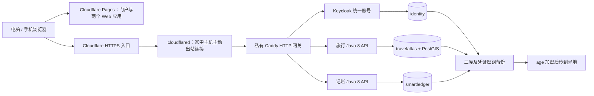

# 不依赖 Oracle 的部署方案：自托管后端 + Cloudflare Pages / Tunnel

日期：**2026-10-26**。适用项目：WhereToGo 个人门户、旅行、独立 SmartLedger、两套 Java 8 API、Keycloak、PostgreSQL/PostGIS。

本文作为新方案独立保存，原《免费部署操作手册》和已有部署文件保持不变。**本次仅提供方案与待创建配置示例，不安装软件、不迁移真实数据、不切换当前服务。** 文中的 `.local/home-tunnel/` 文件需要实施时按示例新建，尚未由本文自动生成。

## 1. 建议采用哪条路线

### 路线 A：优先节省新增费用

**Cloudflare Pages 放两套前端，自己的常开电脑／小主机／NAS 放后端和数据库，通过 Cloudflare Tunnel 访问。**

不依赖 Oracle 注册、不抢免费 VM，不需要家庭公网 IP，不需要在路由器开放入站端口。Cloudflare Tunnel 由家里的连接器主动向外建立连接；前提是家中网络能正常连接 Cloudflare。[Tunnel 工作方式](https://developers.cloudflare.com/tunnel/)。

费用主要是既有设备电费、域名和可选 AI／备份空间。它是“尽量没有新增云服务器租金”，不是“没有任何成本”。

### 路线 B：不想让家中设备一直开机

**两套前端仍放 Pages，租一台普通 Linux 云服务器运行相同后端。**

无须 Oracle，选择自己能正常注册、付款和管理的供应商。建议按 **2 vCPU、8GB RAM、80GB 以上 SSD** 比较报价；4GB 方案需要降低现有容器内存上限、减少构建峰值，不按现有模板直接保证可用。优先比较续费价格、流量和地区，而非首月优惠。

路线 B 可以继续使用本文 Tunnel 架构，避免公开业务端口；也可单独设计公网 HTTPS 入口。费用以下单时官网为准，本文不把试用金和限期活动当作永久免费。

### 如何选择

| 你的条件 | 建议 |
| --- | --- |
| 有一台能常开的电脑／NAS，优先省钱 | 路线 A |
| 电脑经常关机，希望随时能用 | 路线 B |
| 完全不想公开账号、行程、账本接口，只本人设备访问 | 优先考虑私有 VPN／Tailscale 路线；需另行适配访问地址和入口 |
| 没有常开设备，也不接受任何服务器费用 | 继续本机使用；当前架构没有在本文中找到可承诺长期稳定运行的全免费云替代 |

本文以下将 **路线 A** 写成具体操作步骤。路线 B 只需把“家里的 Linux VM”换成买到的 Linux 云服务器，其余配置可复用。

## 2. 为什么暂不推荐把三个 Java 进程拆到免费 PaaS

| 平台／组合 | 与当前系统相关的限制 |
| --- | --- |
| Render Free | 闲置休眠；免费实例运行时长由 workspace 共享；临时文件系统不适合作为数据库和密钥的唯一存储 |
| Koyeb Free | 当前免费实例仅 512MB RAM、0.1 vCPU，不足以把两套 Java API、Keycloak、数据库一起常驻 |
| Zeabur Free | 当前 Free 页面重点是管理自有服务器，不能把控制台免费／试用期当成已赠送持续运行的服务器资源 |
| Pages / Workers 免费层 | 适合前端和部分边缘逻辑，不直接承载当前 Java 8 服务与 PostgreSQL 进程 |

本项目若换成托管 Auth + 更轻后端或 serverless，需要处理身份、角色、退出、数据归属和凭证加密的适配，是另一轮开发工作。

参考：[Render 免费限制](https://render.com/docs/free)、[Koyeb 实例规格](https://www.koyeb.com/docs/reference/instances)、[Zeabur 当前套餐](https://zeabur.com/en-US/pricing)。免费政策会变化，实施前再次核对。

## 3. 新方案架构



公开地址与原项目访问方式一致，示例域名需要替换：

| 地址 | 作用 |
| --- | --- |
| `https://portal.yourdomain.com/` | 门户 |
| `https://portal.yourdomain.com/travel/` | 旅行应用 |
| `https://ledger.yourdomain.com/` | 独立记账应用 |
| `https://identity.yourdomain.com/realms/personal` | 统一账号 issuer |
| `https://travel-api.yourdomain.com` | 旅行 API |
| `https://ledger-api.yourdomain.com` | 记账 API |

三个后端域名指向 Tunnel；**不创建指向家庭 IP 的 A 记录**。两套前端使用 Pages 自定义域名。建议都放在同一根域名下，减少跨站 Cookie 对静默 SSO 的影响。

## 4. 需要哪些账号、软件和资源

### 4.1 账号

1. 已有 GitHub 账号和当前仓库。
2. Cloudflare 账号，启用 MFA，域名 DNS 托管到 Cloudflare。
3. 自己控制的域名；已有域名可以复用。免费 DNS／Tunnel 不代表免费赠送域名。
4. 异地备份账号，可以复用坚果云，但建立独立备份应用密码和目录。

Tunnel 可用于免费计划，发布稳定的公开应用需要 Cloudflare 上的域名。[Tunnel 前提条件](https://developers.cloudflare.com/tunnel/get-started/)。Cloudflare Access 可作为管理入口的额外保护，套餐及是否要求验证／付款方式以实际界面为准；不愿绑定付款方式时不要误选收费套餐，本文保留管理员 IP 限制和 Keycloak MFA 作为基础保护。

### 4.2 自托管设备

| 项目 | 建议 |
| --- | --- |
| Linux VM／主机 | Ubuntu 24.04 LTS，2–4 vCPU，8GB RAM 起，12GB 更宽裕 |
| 物理 Windows 主机 | 能在 VM 外给日常使用留足内存；建议总内存 16GB 以上 |
| VM 磁盘 | 80–100GB SSD 起步，不把数据库放在临时目录／网络同步盘中 |
| 网络 | 持续可用的出站连接；使用有线网络更稳妥 |
| 运行时间 | 需要用应用时，主机和 VM 都要保持运行，关闭休眠／合盖睡眠需按自身使用习惯设置 |

现有后端模板内存上限合计已经超过 5GB，再加连接器、系统缓存和构建峰值，不能用“数据库很小”推断 2GB VM 足够。

### 4.3 本机安装位置

按你之前的要求，Windows 新软件和虚拟机文件放在：

```text
D:\Application\Virtualization\        虚拟化软件或相关文件（如确需安装）
D:\Application\WhereToGoVM\           Ubuntu 虚拟磁盘和配置
D:\Application\age\                  Windows age 工具
D:\Application\WhereToGo\backup-keys\ age 离线私钥
```

已有合适的 Linux VM／NAS 可复用，不必再装 Docker Desktop。**使用单独生产目录和数据卷，不把目前调试中的开发环境直接暴露出去。** Linux 侧按下文使用 `/opt/wheretogo`。

虚拟化能力与 Windows 版本有关，Hyper-V 并非每个 Windows 版本都可用；实施时选当前设备支持的虚拟化方式，或直接用现有 Linux 主机。本文不自动更改系统功能。

## 5. 先准备前端和 Linux 主机

### 5.1 两套 Pages

在 Cloudflare 创建两个连接 GitHub 的 Pages 项目，只授权当前仓库：

| 设置 | 门户与旅行 | 记账 |
| --- | --- | --- |
| 分支 | `master` | `master` |
| 根目录 | `frontend` | `smartledger/frontend` |
| 构建命令 | `npm ci && npm run build` | `npm ci && npm run build` |
| 输出目录 | `dist` | `dist` |
| `NODE_VERSION` | `24` | `24` |
| 自定义域名 | `portal.yourdomain.com` | `ledger.yourdomain.com` |

先保留项目配置，生成第 5.3 节的公开环境变量后再完整构建。生产只使用正式域名；预览站不要加入生产 OIDC 回调通配白名单。

### 5.2 Linux 主机安装

在 Ubuntu 24.04 的终端中：

```bash
sudo apt-get update
sudo apt-get install -y git
sudo git clone https://github.com/tokirin994/WhereToGo.git /opt/wheretogo
cd /opt/wheretogo
sudo bash scripts/production/bootstrap-ubuntu.sh
sudo docker compose version
```

复用已有安装器，但不运行原公网启动脚本。需要 **Compose 2.24.4 以上**，后面的覆盖文件使用 `!reset`／`!override` 来真正移除旧端口和挂载；普通数组合并会保留旧端口。[Compose 合并规则](https://docs.docker.com/reference/compose-file/merge/)。

Linux VM 不需要在家庭路由器开放 22、80、443、5432、8080、8090；SSH 只在可信局域网或私有 VPN 内使用。cloudflared 需要能够向 Cloudflare 出站连接，包含所需的 TCP／UDP 7844；不要把“允许出站”配置成“路由器转发入站”。

### 5.3 生成独立生产配置

先在 Windows 生成 age 备份密钥：

```powershell
.\scripts\production\New-BackupKey.ps1
```

工具安装与离线密钥保管可参考已有 [免费部署操作手册](免费部署操作手册.md) 第 4 节；只把公钥 `wheretogo-backup-recipient.txt` 复制到 Linux，例如 `/home/你的Linux用户名/backup-recipient.txt`，不要上传 `.agekey` 私钥。

在 Linux 执行，下列占位符全部换成真实值：

```bash
cd /opt/wheretogo
sudo python3 scripts/production/prepare.py \
  --portal https://portal.yourdomain.com \
  --ledger https://ledger.yourdomain.com \
  --identity-host identity.yourdomain.com \
  --travel-api-host travel-api.yourdomain.com \
  --ledger-api-host ledger-api.yourdomain.com \
  --email YOUR_REAL_EMAIL \
  --admin-cidr YOUR_OPERATOR_PUBLIC_IP/32 \
  --backup-recipient-file /home/YOUR_LINUX_USER/backup-recipient.txt
```

生成器本身不依赖 Oracle。`ADMIN_ALLOWED_CIDRS` 仍限制管理人员真实公网 IP，后面的网关会安全解析 Tunnel 带来的客户端 IP。不要填家庭 LAN 地址或全网 `0.0.0.0/0`。

文件位于 root-only 的 `.local/production/`。已有配置时生成器拒绝重建；不能为了换方案覆盖原 AES 密钥或生产数据库。

读取两份**公开** Pages 配置，填到对应项目 Production 环境变量后重新构建：

```bash
sudo cat .local/production/portal-pages.env
sudo cat .local/production/ledger-pages.env
```

不把数据库、Tunnel、坚果云、AI 密钥填入任何 `VITE_*` 变量。

## 6. 创建固定域名的 Cloudflare Tunnel

1. 在 Cloudflare 控制台的 **Networking → Tunnels** 创建一个 remotely managed tunnel，命名如 `wheretogo-home`。若当前界面把入口放在 Zero Trust → Networks，则选 cloudflared 连接器。
2. 进入连接器安装步骤，取得该 Tunnel 的 token。**只取 token 内容，不把整个 Docker 命令直接运行，不将 token 写入本文或 Git。**
3. 在 Linux 创建文件：

   ```bash
   cd /opt/wheretogo
   sudo install -m 0644 /dev/null .local/production/secrets/cloudflared-token
   sudoedit .local/production/secrets/cloudflared-token
   ```

   文件只保存 token 本身。`0644` 用于让连接器普通 UID 读取；宿主机父目录保持 root-only。若文件已经存在，先查看配置状态，不重复执行会清空文件的 `install` 命令。

4. 在 Tunnel 的 **Published application routes / Public hostnames** 增加三条路由：

   | 公共 hostname | Service | HTTP Host Header（高级 HTTP 设置） |
   | --- | --- | --- |
   | `identity.yourdomain.com` | `http://gateway:8080` | `identity.yourdomain.com` |
   | `travel-api.yourdomain.com` | `http://gateway:8080` | `travel-api.yourdomain.com` |
   | `ledger-api.yourdomain.com` | `http://gateway:8080` | `ledger-api.yourdomain.com` |

5. 这会为 Tunnel 建立相应 DNS 路由；先删除同名的冲突 A／AAAA 记录。不要把 service 写成 `localhost:8080`，因为连接器和业务服务在不同容器里。

连接器在第 8 节启动后才会变为 Healthy，此时还不健康不代表需要重新创建 Tunnel。`--token-file` 是官方支持的方式，需要 cloudflared 2025.4.0 以上。[连接器参数](https://developers.cloudflare.com/cloudflare-one/networks/connectors/cloudflare-tunnel/configure-tunnels/run-parameters/)。

### HTTPS 与缓存

- 用户访问固定域名的 HTTPS，浏览器到 Cloudflare 的 TLS 由 Cloudflare 提供。
- cloudflared 到 Cloudflare 使用加密出站隧道；最后一段 `gateway:8080` 的 HTTP 仅在同一 VM 的私有 Docker 网络内。
- 三个后端 hostname 设置缓存绕过，不启用 Cache Everything，不把登录、token、API 响应放进公共缓存；网关也返回 `Cache-Control: no-store`。
- 保持外部 OIDC issuer 为 HTTPS，Keycloak 代理头显式声明 HTTPS，不能因内部是 HTTP 就把生产 issuer 改成 localhost。

## 7. 管理入口怎么保护

基础保护包括：Caddy 真实客户端 IP 白名单、Keycloak 强密码／MFA、关闭开放注册、API 用户 subject 白名单。

可以额外在 Cloudflare Access 建 Self-hosted 应用，只允许自己的邮箱或 IdP 身份访问管理路径。若启用，**同时覆盖父路径与子路径**：

```text
identity.yourdomain.com/admin
identity.yourdomain.com/admin/*
identity.yourdomain.com/realms/master
identity.yourdomain.com/realms/master/*
```

不要只保护 `/admin/*` 却误以为无斜杠 `/admin` 也必然匹配；路径规则也有优先级，检查更具体的规则是否放行。[Access 路径匹配](https://developers.cloudflare.com/cloudflare-one/access-controls/policies/app-paths/)。

**不要把 Access 登录挑战套到三个后端整个站点上。** 普通业务仍由 personal realm 的 JWT 管理，否则 SPA 的跨域 API、JWKS 和 OIDC 请求可能收到 HTML 登录页，出现 CORS 错误或循环登录。

Access 也不替代 Keycloak MFA；管理员公网 IP 变化时先从局域网终端更新 `.local/production/.env`，再重新创建 gateway。手机网络 IP 经常变化，不适合作为固定管理白名单。

## 8. 实施时需要新增的配置

以下示例全部在 Linux 新建，放到已被 Git 忽略的 `.local/home-tunnel/`，不覆盖旧部署文件：

```bash
cd /opt/wheretogo
sudo install -d -m 0700 .local/home-tunnel
```

### 8.1 `.local/home-tunnel/Caddyfile`

用 `sudoedit .local/home-tunnel/Caddyfile` 保存以下内容，然后将文件设为 `0644`，供容器读取；外层 `.local/home-tunnel` 仍为 `0700`：

```caddyfile
{
    admin off
    auto_https off
    servers {
        trusted_proxies static 172.29.231.3/32
        trusted_proxies_strict
        client_ip_headers CF-Connecting-IP
    }
}

:8080 {
    header {
        -Server
        Strict-Transport-Security "max-age=31536000"
        X-Content-Type-Options nosniff
        Referrer-Policy no-referrer
        Cache-Control "no-store"
    }

    @identity host {$IDENTITY_HOST}
    handle @identity {
        @blocked_admin {
            path /admin /admin/* /realms/master /realms/master/*
            not client_ip {$ADMIN_ALLOWED_CIDRS}
        }
        respond @blocked_admin "Administration is restricted." 403
        reverse_proxy identity:8080 {
            header_up Host {$IDENTITY_HOST}
            header_up X-Forwarded-For {client_ip}
            header_up X-Forwarded-Host {$IDENTITY_HOST}
            header_up X-Forwarded-Proto https
            header_up X-Forwarded-Port 443
            header_up -X-Real-IP
        }
    }

    @travel host {$TRAVEL_API_HOST}
    handle @travel {
        request_body {
            max_size 1MB
        }
        reverse_proxy travel-api:8080 {
            header_up -X-Forwarded-For
            header_up -X-Forwarded-Host
            header_up -X-Forwarded-Proto
            header_up -X-Forwarded-Port
            header_up -X-Real-IP
        }
    }

    @ledger host {$LEDGER_API_HOST}
    handle @ledger {
        request_body {
            max_size 11MB
        }
        reverse_proxy ledger-api:8090 {
            header_up -X-Forwarded-For
            header_up -X-Forwarded-Host
            header_up -X-Forwarded-Proto
            header_up -X-Forwarded-Port
            header_up -X-Real-IP
        }
    }

    handle {
        respond "Not found" 404
    }
}
```

只信任固定连接器 IP `172.29.231.3` 的客户端 IP 头；不信任整个局域网或客户端自行提交的 `X-Forwarded-For`。Keycloak 仍只信任固定网关 IP `172.29.231.2`，沿用原基础 Compose 的设置。[Caddy 可信代理规则](https://caddyserver.com/docs/caddyfile/options)。

### 8.2 `.local/home-tunnel/compose.override.yml`

```yaml
services:
  gateway:
    ports: !reset []
    volumes: !override
      - ../../.local/home-tunnel/Caddyfile:/etc/caddy/Caddyfile:ro
      - caddy-data:/data
      - caddy-config:/config

  cloudflared:
    image: cloudflare/cloudflared:2026.10.3
    restart: unless-stopped
    read_only: true
    cap_drop: [ALL]
    security_opt: [no-new-privileges:true]
    mem_limit: 512m
    command:
      - tunnel
      - --no-autoupdate
      - run
      - --token-file
      - /run/secrets/cloudflared-token
    secrets: [cloudflared-token]
    networks:
      edge:
        ipv4_address: 172.29.231.3
    logging:
      driver: local
      options: {max-size: '10m', max-file: '3'}

secrets:
  cloudflared-token:
    file: ../../.local/production/secrets/cloudflared-token
```

镜像版本取自截至本文日期的 [cloudflared 官方 Release](https://github.com/cloudflare/cloudflared/releases/tag/2026.10.3)，实施时核对镜像可用性及后续安全补丁，不使用来路不明的镜像。

上述相对路径以**第一个** Compose 文件 `deploy/production/compose.yml` 所在目录为基准。要按下一节的文件顺序调用，不能把覆盖文件挪到第一个参数。

### 8.3 `.local/home-tunnel/start.sh`

```bash
#!/usr/bin/env bash
set -Eeuo pipefail
source /opt/wheretogo/scripts/production/common.sh

dc_home() {
  docker compose \
    --env-file "$RUNTIME/.env" \
    -f "$REPO/deploy/production/compose.yml" \
    -f "$REPO/.local/home-tunnel/compose.override.yml" "$@"
}

# Only validates the merged definition; never print resolved secrets/configuration publicly.
dc_home config --quiet
for service in db identity travel-api ledger-api; do
  dc_home build --pull "$service"
done

dc_home up -d db identity gateway cloudflared
wait_https "https://$IDENTITY_HOST/realms/$IDENTITY_REALM/.well-known/openid-configuration"
dc_home up -d travel-api ledger-api
wait_https "https://$TRAVEL_API_HOST/api/v1/health"
wait_https "https://$LEDGER_API_HOST/actuator/health"
dc_home exec -T -u postgres db psql -v ON_ERROR_STOP=1 -U postgres -d postgres \
  < "$REPO/deploy/production/runtime-grants.sql"
echo 'Home tunnel services started. Configure real user subjects before using business APIs.'
```

启动：

```bash
cd /opt/wheretogo
sudo chmod 0644 .local/home-tunnel/Caddyfile
sudo bash .local/home-tunnel/start.sh
```

首次启动如果等待 HTTPS 超时，先检查 Tunnel Healthy、三条路由、Host Header 和家中出站网络；不要反复运行密钥生成器。

本路线**使用新入口**，不要直接运行原 `scripts/production/start.sh` 或 `scripts/production/update.sh`。它们只加载原 Compose，会恢复旧网关配置及 80/443 绑定。

## 9. 创建账号和启用业务访问

1. 从管理员白名单公网 IP 打开 `https://identity.yourdomain.com/admin/`，启用了 Access 时先通过 Access。
2. 临时管理员 `bootstrap-admin`；只在自己的终端查看初始密码：

   ```bash
   sudo cat .local/production/secrets/identity-admin-password
   ```

3. 在 master realm 建长期恢复管理员、分配所需管理角色、设置强密码和 OTP；另开窗口确认能登录后再清理临时管理员。
4. 在 personal realm 创建日常账号，启用 MFA。不要给日常账号 master 超级管理员权限。
5. 复制该用户 ID，即 token 的 `sub`，用 `sudoedit .local/production/.env` 替换 `API_ALLOWED_SUBJECTS` 的全零占位值。家庭成员用逗号分隔多个 ID，不填用户名或邮箱。
6. 使用两个 Compose 文件重新创建 API，以加载白名单：

   ```bash
   sudo bash -c '
     source /opt/wheretogo/scripts/production/common.sh
     docker compose --env-file "$RUNTIME/.env" \
       -f "$REPO/deploy/production/compose.yml" \
       -f "$REPO/.local/home-tunnel/compose.override.yml" \
       up -d travel-api ledger-api
   '
   ```

生产默认关闭自助注册；如要开放注册，另配 SMTP、邮箱验证和准入规则。门户公开展示，点击旅行／记账才进入统一登录。

## 10. 数据安全范围

### 已有机制继续使用

- 三个数据库、独立数据库账号与私有数据网络；数据库不发布宿主机端口。
- 两套 API 校验相同 issuer、不同 audience，业务按账号隔离，启用 subject 白名单。
- 坚果云账号及应用密码用 AES-256-GCM 加密，密钥在数据库外的文件中。
- age 加密完整异地备份，离线私钥放在独立设备；主机系统／磁盘保护另做。
- 本地开发 mock 登录保持关闭，不把开发 profile 用于对外服务。

### Tunnel 带来的信任边界

**Cloudflare 会终止用户侧 TLS，可处理经过入口的解密请求。** “隧道是加密的”不等于“Cloudflare 看不到账本内容”。当前系统没有账本端到端加密，家中主机管理员也能访问运行中的业务数据。

如果这不符合你的隐私要求，应选择只有本人设备加入的私有网络访问方式，并另行适配域名、HTTPS 和入口；不要把数据经过第三方 TLS 终止代理描述成第三方不可读。

Tunnel token 泄露后要在 Cloudflare 轮换，并更新本机文件／重启连接器；不要只删除 Git 里的旧字符串。对原始 OCR 文件、导出报表和 App 内坚果云 JSON 的保护范围，仍以原项目文档为准，不能将它们自动视为已 age 加密。

## 11. 备份与恢复：新增配置也必须备份

### 11.1 三库、账号和凭证密钥

仍可使用原 `scripts/production/backup.sh`：它对相同项目名的 API／身份服务执行 stop/start、在数据库容器内导出，不会重新创建 gateway。**不要改变基础项目名 `wheretogo-production`。**

先按 [原操作手册](免费部署操作手册.md) 的备份章节配置独立 rclone 目标，再执行：

```bash
sudo bash scripts/production/backup.sh
sudo bash scripts/production/install-backup-timer.sh
```

每天香港时间 03:30 左右备份，会短暂停止写入服务。不要在备份期间执行新启动／升级操作。只有 `--local-only` 的备份仍留在同一台物理电脑上，不足以抵御整机丢失或硬盘故障。

### 11.2 新增的 Tunnel 覆盖配置

原备份脚本包含 `.local/production` 的指定配置与三库，**不会自动包含 `.local/home-tunnel`**。Tunnel token 放在 production 的 secrets 目录，会随加密归档备份；但新 Caddyfile／覆盖文件／启动入口要另外备份。

首次设置完成以及每次修改之后，在 Linux 执行下面的加密配置备份。前提是已经设置有效的 rclone 异地目标：

```bash
sudo bash <<'BASH'
set -Eeuo pipefail
source /opt/wheretogo/scripts/production/common.sh
[[ -n ${BACKUP_RCLONE_DEST:-} ]] || { echo 'Configure the off-site backup destination first.' >&2; exit 1; }
umask 077
name="home-tunnel-config-$(date -u +%Y%m%dT%H%M%SZ).tar.age"
output="$RUNTIME/backups/$name"
tar -C "$REPO/.local" -czf - home-tunnel \
  | age -R "$RUNTIME/backup-recipients.txt" -o "$output"
(cd "$RUNTIME/backups" && sha256sum "$name") > "$output.sha256"
rclone --config "$RUNTIME/rclone.conf" copyto --immutable \
  "$output" "${BACKUP_RCLONE_DEST%/}/$name"
rclone --config "$RUNTIME/rclone.conf" copyto --immutable \
  "$output.sha256" "${BACKUP_RCLONE_DEST%/}/$name.sha256"
echo 'Tunnel configuration encrypted and copied off-site.'
BASH
```

定时器不自动包含这一额外步骤，所以配置变更后要手动补做并检查异地文件；也可后续独立实现 Tunnel 专用备份入口。

### 11.3 换机器恢复

1. 准备新 Ubuntu 主机，安装工具，检出数据库备份清单中的同一代码 commit；不先生成新密钥。
2. 在可信恢复环境核对 SHA-256，使用离线私钥和原空机恢复脚本恢复三库与密钥。脚本拒绝覆盖现有生产数据卷。
3. 将可信的 Tunnel 配置归档解密恢复到 `.local/home-tunnel`，保留 root-only 目录和 Caddyfile 容器读取权限；若不使用归档，则按本文重新创建三个文件。
4. 关闭旧连接器后，在新机器启用 Tunnel。若怀疑旧主机泄露，先轮换 token；新旧机器同时接同一个 Tunnel、但连着不同数据库，会导致请求分流到不同数据源，不能当作高可用部署。
5. 使用 **`.local/home-tunnel/start.sh`** 启动。不要根据旧恢复脚本末尾通用提示，误运行原公网启动入口。
6. 保留原 issuer、realm 和用户 subject，核对账本、旅行及加密凭证后，再清理恢复机上的临时 age 私钥。

必须恢复自己可信的备份；加密和校验和不等于给任意第三方 SQL／配置归档赋予执行权限。

## 12. 更新、开机自启和运行状态

### 更新

保留更新前的异地备份，获取并审阅目标完整 commit，在没有本地受跟踪文件改动的情况下手动切换，再使用 Tunnel 专用入口重建：

```bash
cd /opt/wheretogo
sudo bash scripts/production/backup.sh
sudo git fetch origin master
# 核对目标 commit 属于计划发布的版本后，再执行：
sudo git checkout --detach REVIEWED_FULL_COMMIT_SHA
sudo bash .local/home-tunnel/start.sh
```

新配置是 ignored 本地文件，不会随代码自动覆盖；版本若改变服务名、网络或基础 Compose，要同时审阅覆盖文件。数据库迁移之后不能保证只切回旧代码即可回滚，必要时恢复更新前备份。

### 开机自启

容器配置 `restart: unless-stopped`，Docker 已启用服务时会在 Linux 开机后恢复之前运行的容器；它不会替你启动被手动停止的服务，也不能唤醒关闭的物理电脑。

Windows 场景还要单独确认 VM 随主机启动、主机不因休眠断开网络。先设置断电恢复／VM 自启策略，再观察一次正常重启后的状态；不把这一配置当作本文已经替你完成。

### 状态和日志

使用同一个覆盖组合查看：

```bash
sudo bash -c '
  source /opt/wheretogo/scripts/production/common.sh
  docker compose --env-file "$RUNTIME/.env" \
    -f "$REPO/deploy/production/compose.yml" \
    -f "$REPO/.local/home-tunnel/compose.override.yml" ps
'
```

需要日志时将最后的 `ps` 换成 `logs --tail 100 cloudflared gateway identity`。不要开启带请求正文的 debug 日志或公开 token、回调 code、账目明细。

## 13. 性能和费用怎么判断

### 性能

- 前端静态资源由 Pages CDN 提供；后端不因免费 PaaS 休眠而主动冷启动。
- 实际响应还受家宽上行、主机 CPU、Cloudflare 链路、DNS 和停电影响；“Tunnel Healthy”只表示连接器连通，不证明业务 API 或数据库正常。
- 本项目 OCR 主要在浏览器执行，大图、PDF 的耗时更多受用户设备和首次资源下载影响；购买更大服务器不能直接提高所有识别准确率。
- 内存、功耗、吞吐均为配置建议，未做真实家宽／手机网络的性能测量。

### 电费示例

```text
每月用电量 ≈ 平均功率 W ÷ 1000 × 24 × 30
```

10W 常开设备约 7.2 kWh/月，60W 约 43.2 kWh/月；乘以你的电价。该算式不包含显示器、路由器额外功耗，也不代表你电脑的实测功耗。如果本来不会常开电脑，路线 A 未必比普通云服务器更省钱。

### 域名与套餐

域名续费、AI、备份空间可能收费；Tunnel／Pages 选择免费计划并遵守额度。不要开启 Argo Smart Routing、付费 WAF、付费 Workers 或其他收费增值能力来完成本方案，除非自己已决定购买。

## 14. 可选：普通云服务器替代家中主机

如果不愿依赖家中设备运行，可以直接把第 5 节 Linux 主机换成普通供应商的 Ubuntu 24.04 服务器，继续使用相同 Tunnel 覆盖配置。

下单核对：

- 有足够 RAM，磁盘为持久 SSD，地区到自己的网络可接受；查看月流量和超额计费规则。
- 能正常注册、实名和付款；不依赖 Oracle 的注册流程，也不强求“免卡永久免费”。
- SSH 仅允许管理 IP，业务端口不入站开放；Tunnel 只需出站网络。
- 独立异地备份、恢复演练和维护更新仍要保留，付费服务器不自动替代这些工作。
- 不把银行、证件或支付信息交给非官方代注册／代抢账户服务。

使用固定公网入口时可另走普通 HTTPS 直连，但这是另一套代理信任配置；不能随意混用 Tunnel 的 `CF-Connecting-IP` 信任设置。

## 15. 实施前后检查清单

1. 旧文档和现有运行服务保持原样，先在独立 VM／目录建立新环境。
2. 新覆盖配置的解析结果只有私有服务，没有 80／443／5432 等宿主机业务端口发布。
3. 三条 Tunnel 路由和 Host Header 都正确；家庭路由器没有开放数据库和开发端口。
4. 外部 issuer、两个客户端回调、CORS、JWT audience 和 subject 白名单匹配。
5. 管理入口受到真实 IP 和 MFA 限制；启用了 Access 时验证其只保护管理路径。
6. 门户可公开看，旅行和记账进入后登录，不出现 HTTP 跳转／重复鉴权循环。
7. API 不带 token 拒绝访问，两个账号的数据隔离，坚果云凭证不会返回明文。
8. 旅行、账本、抵扣、同步和导出按实际使用场景检查；旧 OCR 有 3 项未通过用例，部署新入口不等于已修复识别问题。
9. 三库备份及新 Tunnel 配置都已加密到异地，离线私钥另存，并在空机恢复演练。
10. 浏览器／网络／家中主机关闭等场景实际验证后再作为日常入口；本文没有执行这些部署与端到端测试。

**建议先做路线 A 的空库试用，确认能稳定登录、保存和恢复，再讨论现有本机数据迁移。** `localhost` 的旧 issuer 和新 HTTPS issuer 不同，不能只复制数据库后假定新账号自然拥有旧数据；按原文档迁移章节保留 subject、处理 issuer 与凭证 AAD，或使用有备份的账本快照恢复流程。
