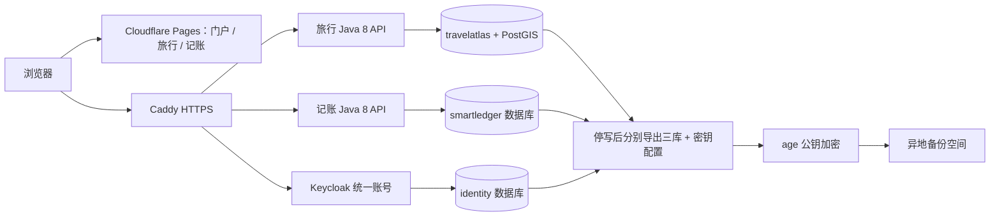

# WhereToGo 个人门户免费部署操作手册

核对日期：**2026-10-25**。适用于本仓库当前的门户、旅行、独立 SmartLedger、Java 8 API、PostGIS 与 Keycloak 统一账号。

## 1. 选择什么方案

**推荐：Cloudflare Pages × 2 + Oracle Cloud A1 免费主机 × 1 + 自托管 PostgreSQL/PostGIS 与 Keycloak + 加密异地备份。**

前端用 CDN，后端不依赖请求唤醒，三套数据库持久保存在自己的主机上。对于个人和少量家庭成员，这是目前更适合这套 Java 架构的免费资源组合。这里的性能判断是依据组件和资源规模做的估计，不是压测结果。

| 项目 | 配置与费用边界 |
| --- | --- |
| 门户、旅行前端 | 一个 Cloudflare Pages 项目，`frontend`，免费静态托管 |
| 记账前端 | 第二个 Pages 项目，`smartledger/frontend`，免费静态托管 |
| 后端、登录、数据库 | OCI `VM.Standard.A1.Flex`，**合计 2 OCPU / 12GB**；当前免费配额为每月 1,500 OCPU 小时、9,000 GB 小时，不按旧教程的 4 核 / 24GB 创建 |
| 系统盘与数据 | 建议先分配 100GB；启动盘和块存储合计保持在当前 200GB 免费范围内，控制台须显示免费资格 |
| HTTPS | Caddy 自动申请和续期证书，无证书购买费用 |
| 域名 | 用自己已有域名；没有域名时，域名注册／续费通常另计，本文不承诺全项目零花费 |
| 备份 | 复用已有坚果云 WebDAV 空间，或另一台设备／其他 rclone 存储。检查账户流量、容量和单文件限制 |
| AI | 可不配置，不影响手工规划、记账与本地 OCR；接入 DS、GLM、GPT、Claude 等需自行承担供应商费用 |

Oracle 免费资源仅在 home region 使用，可能缺货，闲置实例可能被回收；免费套餐不提供可用性 SLA。**备份必须离开这台 VM**，否则主机消失时，同机数据库和备份可能同时丢失。[Oracle 当前额度与回收政策](https://docs.oracle.com/en-us/iaas/Content/FreeTier/freetier_topic-Always_Free_Resources.htm)、[注册与验证要求](https://www.oracle.com/cloud/free/faq/)。

Pages 免费层目前每月 500 次构建，单文件 25 MiB。仓库会将 PDF 解析资源复制到静态文件，部署时仍需遵守单文件限制。[Pages 限制](https://developers.cloudflare.com/pages/platform/limits/)。

### 为什么不把所有东西直接放 Render 免费层

当前有两个 Java API 和一个长期运行的 Keycloak，不是一份静态网页。Render 免费服务闲置 15 分钟后休眠，唤醒约一分钟；每个 workspace 的 750 免费实例小时由服务共享，不能理解为三个服务都能各自免费常驻一整月。免费 PostgreSQL 还会在 30 天后到期。[Render 免费限制](https://render.com/docs/free)。

Supabase 可以作为 PostGIS 数据库的备选，但免费项目低活跃可能暂停，免费用户应自行异地导出备份；它也没有替代本项目当前的 Keycloak 账号与管理适配。故不把它作为这份主流程的额外依赖。[项目暂停](https://supabase.com/docs/guides/platform/free-project-pausing)、[数据库备份](https://supabase.com/docs/guides/platform/backups)。

## 2. 部署后的地址和结构

以下使用 `yourdomain.com` 举例，全部替换成你自己的域名。

| 地址 | 用途 | 去向 |
| --- | --- | --- |
| `https://portal.yourdomain.com/` | 公开个人门户 | Pages 项目一 |
| `https://portal.yourdomain.com/travel/` | 登录后旅行应用 | 同一个 Pages 项目 |
| `https://ledger.yourdomain.com/` | 登录后独立记账 | Pages 项目二 |
| `https://identity.yourdomain.com/realms/personal` | 同一套账号、SSO、MFA | VM 上 Keycloak |
| `https://travel-api.yourdomain.com` | 旅行 API | VM 上 Java 8 |
| `https://ledger-api.yourdomain.com` | 记账与坚果云 API | VM 上 Java 8 |



三库共用一个 PostgreSQL 进程，减少内存开销，但账号、库权限和容器数据网络分开。运行账号没有建表／迁移历史修改权限，Flyway 使用单独迁移账号。只有 Caddy 发布公网 80/443；5432、8080、8090、9000 不发布到宿主机。

建议三个登录相关站点都使用同一根域名下的子域。仅使用两个 `pages.dev` 域名再搭配第三方登录域名，可能受到浏览器第三方 Cookie 限制，影响静默 SSO／退出检测。生成后不要随意更换生产访问域名。

## 3. 需要注册什么

按顺序准备：

1. **GitHub**：使用当前仓库 `tokirin994/WhereToGo`。只给 Pages 授权这个仓库，不必授权全部仓库；不需要给 VM 一个能推送代码的 GitHub token。
2. **Oracle Cloud**：[注册入口](https://signup.cloud.oracle.com/)。通常需要真实邮箱、手机、地址及符合要求的银行卡做身份验证。免费账户资格与是否有空闲 A1 容量要以控制台为准；不要为了照搬本教程升级付费或选更大实例。
3. **Cloudflare Free**：[控制台](https://dash.cloudflare.com/)。启用 MFA，把自己控制的域名添加到 Cloudflare，按页面提示去域名注册商更改 nameserver。DNS 生效后再继续。
4. **域名注册商**：已有域名无需重新购买；没有域名则先选择注册商并确认续费价。Cloudflare 免费 DNS 不等于免费赠送域名。
5. **备份存储**：可复用已有坚果云。给服务器备份建立独立第三方应用密码、独立目录，与记账 App 的快照备份分开。不要把密码贴到仓库或聊天里。

Oracle home region 选靠近实际使用地、能提供 A1 的区域。中国大陆访问海外机房的延迟与连通性会受运营商影响；免费配置无法承诺低延迟或稳定跨境网络。

## 4. 先在本电脑保管备份私钥

Windows 新软件按你指定的规则放到 **`D:\Application\应用名`**。不需要为了部署在本电脑安装 Docker／Java；这些在服务器容器内运行。

1. 从 [age 官方 Releases](https://github.com/FiloSottile/age/releases/latest) 下载 Windows 架构对应压缩包，按照同一官方 Release 提供的摘要／校验方式核对下载。解压后确保以下文件存在：

   ```text
   D:\Application\age\age.exe
   D:\Application\age\age-keygen.exe
   ```

2. 在本机 PowerShell，仓库根目录运行：

   ```powershell
   .\scripts\production\New-BackupKey.ps1
   ```

3. 将生成的 `D:\Application\WhereToGo\backup-keys\wheretogo-backup.agekey` 再复制一份到受保护的离线介质。**丢失私钥就无法解密备份**。
4. 之后只把 `wheretogo-backup-recipient.txt` **公钥文件**传给服务器。正常备份时服务器不需要、也不应持有 age 私钥。

脚本不会覆盖已存在的密钥，会收紧本地目录 ACL。Windows 当前用户、SYSTEM 和本机管理员仍能读取，所以它不替代整盘加密和管理员账号保护。

## 5. 创建 Oracle 免费主机

在 OCI 控制台：

1. 创建专用 compartment，例如 `personal-apps`，先设预算通知。预算通知不是自动停止收费的硬限制。
2. **Compute → Instances → Create instance**。
3. Image 选择 **Ubuntu 24.04 LTS，Arm64**；Shape 为 **`VM.Standard.A1.Flex`**，分配 **2 OCPU、12GB RAM**。若控制台没有免费资格或提示容量不足，停止创建，换可用域／稍后重试，不自动切换成收费机型。
4. 启动盘建议 **100GB**，使用默认免费适用性能档；创建前确认启动盘与其他块存储总额、VPU、IP 等都符合账户当前免费政策。不要额外购买负载均衡器、NAT Gateway 或备份产品来完成本教程。
5. 创建公网子网与 internet gateway，分配可访问的公网 IP。保存实例页面显示的 SSH 公钥／私钥；私钥放在本机受保护目录，不上传 GitHub。
6. 在实例 VNIC 绑定的 NSG 或子网 Security List 设置入站：

   | 端口 | 来源 |
   | --- | --- |
   | TCP 22 | 你当前公网 IP `/32`；使用 IPv6 则对应 `/128` |
   | TCP 80、443 | 正常公网客户端；初期只启用 IPv4 也可以 |
   | 5432、8080、8090、9000 | **不添加** |

7. 使用公钥 SSH，不开放 SSH 密码登录。在更改 SSH／防火墙配置前保持当前连接，另开一次新连接确认自己仍能登录。

Docker 发布端口可能绕过 UFW，所以不能仅凭 `ufw deny 5432` 认为数据库安全。本配置根本不发布数据库端口，并依赖 OCI 的入站规则限制 SSH。[Docker 防火墙说明](https://docs.docker.com/engine/install/ubuntu/)。

## 6. Cloudflare DNS 与两个 Pages 项目

### 6.1 后端三个 DNS 记录

在 Cloudflare DNS 添加三条 A 记录，内容均为 VM 公网 IP：

```text
identity     -> VM_IP
travel-api   -> VM_IP
ledger-api   -> VM_IP
```

这三条先设置 **DNS only（灰云）**：浏览器与服务器 Caddy 直接建立 HTTPS，避免额外的代理缓存／登录限制；Cloudflare 仍负责 DNS。不要发布没有正确接通的 AAAA 记录。

本配置管理员限制依据直接连接 IP。如果改成橙云，需要先正确配置可信代理与真实 IP 规则，不能原样使用目前的管理员 IP 判断；也不要给这些 API／登录域名启用 Cache Everything。

### 6.2 创建 Pages 项目

在 **Workers & Pages → Create → Pages → Connect to Git**（界面名称调整时选“连接 Git 仓库部署静态站点”），只授权 `WhereToGo`。建立两个项目：

| 设置 | 门户／旅行 | 独立记账 |
| --- | --- | --- |
| Production branch | `master` | `master` |
| Root directory | `frontend` | `smartledger/frontend` |
| Build command | `npm ci && npm run build` | `npm ci && npm run build` |
| Output directory | `dist` | `dist` |
| 环境变量 `NODE_VERSION` | `24` | `24` |
| Custom domain | `portal.yourdomain.com` | `ledger.yourdomain.com` |

首次可以先保存项目，待下一节生成真实环境变量后重新构建。若第一次构建因地址／登录配置缺失失败，不要通过开启 mock 登录来绕过。Pages 的 Custom domains 界面绑定两个域名，等待 DNS 和证书生效；从此以这两个正式域名访问。

配置 Production 分支构建；预览部署先关闭，或单独建 staging 身份 realm。不要把 `*.pages.dev` 通配域名加入生产 CORS／OIDC 回调。[Pages Git 部署](https://developers.cloudflare.com/pages/get-started/git-integration/)。

## 7. 在服务器生成配置与启动

### 7.1 SSH 和程序安装

本机 PowerShell，把私钥文件名、IP 替换成真实值：

```powershell
ssh -i 'D:\Application\WhereToGo\ssh\oci.key' ubuntu@VM_IP
```

在新服务器执行：

```bash
sudo apt-get update
sudo apt-get install -y git
sudo git clone https://github.com/tokirin994/WhereToGo.git /opt/wheretogo
cd /opt/wheretogo
sudo bash scripts/production/bootstrap-ubuntu.sh
```

私有仓库需要给服务器配置只读 Deploy key；不将个人可写 token 写进 clone URL。安装脚本仅用于 Ubuntu 24.04，通过 Docker 官方 apt 仓库安装 Engine/Compose，并安装 age/rclone/基础工具，不修改 SSH 或云防火墙，也不把普通用户加入具有 root 权限的 docker 用户组。

### 7.2 上传公钥并生成

在本机另一个 PowerShell 上传 **age 公钥**：

```powershell
scp -i 'D:\Application\WhereToGo\ssh\oci.key' `
  'D:\Application\WhereToGo\backup-keys\wheretogo-backup-recipient.txt' ubuntu@VM_IP:/home/ubuntu/backup-recipient.txt
```

回到服务器；将 `YOUR_PUBLIC_IP/32` 替换成你访问管理后台时的真实公网 IP，不能直接填示例 IP：

```bash
cd /opt/wheretogo
sudo python3 scripts/production/prepare.py \
  --portal https://portal.yourdomain.com \
  --ledger https://ledger.yourdomain.com \
  --identity-host identity.yourdomain.com \
  --travel-api-host travel-api.yourdomain.com \
  --ledger-api-host ledger-api.yourdomain.com \
  --email YOUR_REAL_EMAIL \
  --admin-cidr YOUR_PUBLIC_IP/32 \
  --backup-recipient-file /home/ubuntu/backup-recipient.txt
```

生成位置：`/opt/wheretogo/.local/production/`，已被 Git 忽略。包含随机数据库密码、AES-256 凭证密钥、无预设用户的生产 realm、两个 Pages 公开配置文件及备份公钥。**已有配置时脚本直接拒绝执行，防止重新生成密钥导致旧凭证无法解密。**

宿主机配置目录限 root 访问。Secret 文件本身允许容器普通 UID 读取，但宿主机父目录仅 root 可遍历；这是本机 Compose 文件挂载，不是独立 Secret 管理服务。宿主机 root、Docker 管理员仍可读取秘密。

### 7.3 Pages 环境变量

在服务器运行以下命令，只显示可以公开进入浏览器的地址和客户端 ID：

```bash
sudo cat .local/production/portal-pages.env
sudo cat .local/production/ledger-pages.env
```

将对应文件中的键和值填到对应 Pages 项目的 **Production Variables and Secrets**，保留 `NODE_VERSION=24`，然后重新部署。

**不要复制 `.local/production/secrets`、数据库密码、坚果云应用密码或 AI key 到 Pages。所有 `VITE_*` 都会被打包进浏览器，不是秘密存储。**

### 7.4 启动

```bash
sudo bash scripts/production/start.sh
```

脚本按顺序构建镜像，先启动数据库、登录和 Caddy，等待真实 HTTPS 登录发现地址可用后，再启动两套 API，最后授予运行账号所需表权限。首次拉取镜像、编译 Java 与申请证书需要时间；失败时看对应服务日志，不反复重建密钥。

这是 **ARM64 原生构建**。PostGIS 使用官方 PostgreSQL 16 镜像加 PGDG 软件包，不把 x86 镜像强行设成 `linux/amd64` 在 A1 上模拟。[PGDG 支持的架构](https://www.postgresql.org/download/linux/debian/)。

查看服务：

```bash
sudo bash -c 'source scripts/production/common.sh; dc ps'
sudo bash -c 'source scripts/production/common.sh; dc logs --tail 100 identity'
sudo bash -c 'source scripts/production/common.sh; dc logs --tail 100 travel-api ledger-api gateway'
```

不要在公开 issue 中贴含账号、令牌、数据库连接或请求明细的完整日志。

## 8. 建立自己的统一账号

1. 从允许的公网 IP 打开 `https://identity.yourdomain.com/admin/`。
2. 临时管理员名是 `bootstrap-admin`。只在自己的安全终端查看随机初始密码：

   ```bash
   sudo cat .local/production/secrets/identity-admin-password
   ```

3. 在 Keycloak **master realm** 创建一个长期恢复管理员，按 Keycloak 管理员权限要求分配角色，设置强密码和 MFA。用单独窗口确认长期管理员能登录后，再删除临时 bootstrap 管理员。不要先删掉唯一管理员。
4. 切到 **personal realm**，在 **Users → Add user** 创建日常使用账号，设置密码，要求首次登录更新密码并配置 OTP。不要把日常账号设为 master 超级管理员。
5. 复制这个 personal 用户的 **ID**（JWT `sub`，不是邮箱／用户名）。修改服务器公开配置：

   ```bash
   sudoedit .local/production/.env
   ```

   将 `API_ALLOWED_SUBJECTS` 改为真实 ID；家庭多人可用逗号分隔。初始全零 ID 是拒绝所有人的占位，不能原样保留。仍保持 `API_ALLOW_ANY_AUTHENTICATED_USER=false`。

6. 应用白名单，不必重新编译：

   ```bash
   sudo bash -c 'source scripts/production/common.sh; dc up -d travel-api ledger-api'
   ```

7. 门户公开可看，点击应用才登录。两个前端用同一个 issuer 和相同用户；业务数据仍按账号隔离。

生产生成器默认关闭自主注册，适合个人使用。如果希望展示可用注册入口，先配置 SMTP、邮箱验证、防滥用策略，再在 personal realm 开启注册；新增注册用户仍需进入 API 白名单才能用业务服务。没有 SMTP 时不要承诺能用邮件找回密码。

如果要在门户显示账号管理链接，给专门的 personal realm 管理账号按需分配 `portal-admin` 与适当 `realm-management` 角色；普通日常账号不授予用户管理权限。管理员控制台的入口还受 Caddy IP 限制。

## 9. 坚果云、AI 与隐私边界

### 9.1 App 内的坚果云同步

在生产记账 App 的 **更多 → 设置与云同步 → 坚果云 WebDAV** 填写自己的邮箱和第三方应用密码，测试连接，再备份。这些凭证由 API 用 AES-256-GCM 加密后存入数据库，密钥在独立文件挂载中；AAD 还绑定 issuer 与账号 subject。

**只加密了凭证，并未给全部账本做端到端加密。** 当前 IndexedDB、API 数据库中的账本、App 生成的坚果云 JSON 和导出报表都可包含明文业务数据。HTTPS 保护传输，主机磁盘保护与下面的 age 备份保护另外两层；服务器管理员仍可访问运行中的数据。不要将这套方案描述成服务器也看不到账目的 E2EE。

### 9.2 AI key

AI 不是必填项。选择供应商后，在 `.local/production/.env` 设置 `TRAVEL_AI_BASE_URL / MODEL / PROTOCOL / TOKEN_FIELD / AUTH_MODE`，按 [旅行接入说明](旅游服务接入与分期验收.md) 选择 OpenAI Chat Completions、Responses 或 Anthropic Messages 兼容协议。

API key 单独写入 `.local/production/secrets/travel-ai-key`。可以用 `sudoedit` 编辑该文件，文件只放 key 本身，不加 `TRAVEL_AI_API_KEY=` 前缀；保留其容器可读权限和 root-only 父目录。之后重新创建旅行 API：

```bash
sudo bash -c 'source scripts/production/common.sh; dc up -d --force-recreate travel-api'
```

向外部 AI、地名／天气／路线服务发送查询意味着相应目的地、行程提示或坐标会离开自己的主机。账本、坚果云密码和截图不应拼进旅行 AI 提示词。地图和免费公共查询服务也有各自使用规则，适合个人轻量使用，不承诺高并发配额。

## 10. 配置服务器级加密异地备份

它与 App 的“备份到坚果云”是两套机制。服务器级备份覆盖 **旅行库、记账库、身份库、恢复所需 AES 密钥和服务配置**，能恢复账号映射与加密凭证，而不只是账本 JSON。

### 10.1 rclone 配置

```bash
cd /opt/wheretogo
sudo rclone config --config /opt/wheretogo/.local/production/rclone.conf
```

选择：`n` 新建 → 名称 `nutstore-backup` → 存储类型 `webdav` → URL `https://dav.jianguoyun.com/dav/` → vendor 选 Other → 填自己的坚果云邮箱和**独立备份应用密码**。密码交互输入，不放在命令参数或 Git 中。

完成后：

```bash
sudo chmod 600 .local/production/rclone.conf
sudoedit .local/production/.env
```

设置：

```dotenv
BACKUP_RCLONE_DEST=nutstore-backup:WhereToGo-server-backups
BACKUP_KEEP_DAYS=14
```

rclone 配置中的 obscured password 不是强加密，靠宿主机 root-only 目录保护；务必限制其账号权限。远程收到的是 age 密文。可以改成 SFTP／其他 rclone 兼容存储，不要求必须使用坚果云。大文件超过 WebDAV 额度／限制时换其他存储，而不是假定上传成功。

### 10.2 第一次备份和每日定时

```bash
sudo bash scripts/production/backup.sh
sudo bash scripts/production/install-backup-timer.sh
```

每天 **香港时间 03:30 左右**运行，停写两套 API 与登录服务后导出三库，再启动它们、压缩加密、上传。这会带来一段实际维护时间；数据量和启动速度决定时长，没有承诺“零停机备份”。身份库也要备份，才能恢复原账号与数据归属。

若暂时没有异地存储，可以明确运行：

```bash
sudo bash scripts/production/backup.sh --local-only
```

这只生成同机加密备份，**不满足灾难恢复要求**，必须另行复制到本电脑或其他设备；定时器要求先配置异地目标。服务器保留最近 14 天本地文件，异地不自动删旧版本，需定期检查配额并在确认可恢复后手工整理。

检查：

```bash
sudo systemctl list-timers wheretogo-backup.timer
sudo systemctl status wheretogo-backup.service
sudo journalctl -u wheretogo-backup.service --since '7 days ago'
sudo cat .local/production/backup-last-success.txt
```

定时器并不自动发送邮件告警，需自己查看失败状态／设置监控。至少每周确认异地最新文件与 `.sha256` 均已到达，每月做一次下面的空机恢复演练；仅看到“上传成功”不证明能恢复。

## 11. 恢复与升级

### 11.1 灾难恢复，只恢复到空机器

脚本拒绝覆盖已有生产 PostgreSQL volume 和已有配置。不要为了让脚本继续而删除正在使用的数据卷。

1. 创建新 VM，按前述步骤安装 Docker/age，克隆仓库到 `/opt/wheretogo`，**不要运行 prepare.py/start.sh**。
2. 从异地下载备份和 SHA-256 文件，在对应目录使用 `sha256sum -c 文件.sha256` 核对。
3. 在本电脑解密检查清单，或在受控恢复机器临时使用离线私钥解密。归档里的 `manifest.json` 记录代码 commit；服务器先 `sudo git checkout --detach <该完整commit>`。保留原域名与 personal realm 名称，避免 issuer 改变。
4. 将备份及一份临时离线私钥安全上传到恢复 VM、限制为 root 可读，再运行：

   ```bash
   sudo bash scripts/production/restore-empty-server.sh \
     /root/recovery/wheretogo-REPLACE.tar.age \
     /root/recovery/wheretogo-backup.agekey --empty-server
   ```

5. 脚本仅在空环境恢复三库及密钥。`roles-reference.sql` 是角色审计参考，不自动执行任意角色 SQL；本套固定数据库账号由初始化脚本建立，运行权限重新授予。
6. 把原有三个后端域名解析到新 IP；如管理员公网 IP 已变化，更新 `.local/production/.env` 的 `ADMIN_ALLOWED_CIDRS`。保持原 issuer、用户 ID 与 AES keyring。
7. 执行 `sudo bash scripts/production/start.sh`，逐项确认数据和登录后移除服务器上的临时 age 私钥。Caddy 重新申请证书，证书签发可能有等待／频率限制。

备份归档包含 AES 密钥和密码，虽然已 age 加密，也应限制分发。离线 age 私钥不能和这些备份只放在同一个设备或同一账号里。

### 11.2 更新代码

先在 GitHub 查看并确定要部署的完整 40 位 commit，服务器执行：

```bash
cd /opt/wheretogo
sudo bash scripts/production/update.sh FULL_40_CHARACTER_COMMIT_SHA
```

脚本确认工作区无改动、目标 commit 属于远程 master，先完成异地备份，再切换到该 commit 和重新部署。数据库迁移运行后，**切回旧镜像未必能够回滚数据库**；需要恢复时用更新前备份到空环境处理。

Pages 在 master 推送后会自动构建。涉及接口不兼容的升级，要按具体版本先部署兼容 API 再发布前端；首次尚未关联 Pages 时本次推送不会凭空创建公网服务。

## 12. 本电脑已有数据如何迁到线上

**不要只复制 PostgreSQL 数据目录，也不要简单把线上账号的 `user_id` 改成旧 ID。** 本机使用 `http://localhost:8091/realms/local`，本方案使用 HTTPS `personal` realm，issuer 和新用户 subject 可能不同。

- 最稳妥：先用全新线上账号做空库试用，确认流程，再做有备份的迁移。App 内坚果云 JSON 可用于恢复记账快照，但恢复会替换目标本地账本；先备份两端，核对后再同步到线上 API。
- CSV／HTML／Markdown 账本导出是报表，不等于完整系统备份，不能据此还原所有设置、关联抵扣和账号。
- 需要完整搬迁现有本机身份、旅行库、记账库时，应制定**保留 subject 的身份导入与 issuer 更新事务**，同步处理 `users`／`sl_users`，并先演练。当前生产脚本不自动合并账号。
- 坚果云凭证密文绑定旧 issuer/sub，改 issuer 后即使复制旧密钥也不能直接解密；线上重新配置凭证，或执行明确的解密再加密迁移。不要修改密文绑定来绕过账号隔离。
- 先前只保存在浏览器 IndexedDB 的改动，需要在旧地址登录原账号后完成备份／同步，再切换域名；换域名不会自动带走浏览器本地数据。

## 13. 上线后操作检查

按顺序手动检查，本文没有替你创建云账户或部署真实公网环境：

1. 门户未登录时可看，进入旅行／记账才需要登录，不能出现重定向循环。
2. HTTPS 证书正确；两个 API 健康地址可返回；受保护业务接口不带 token 应拒绝访问。
3. 普通账号只能看到自己的记录；另一账号不能读取原账号的账本、旅行、坚果云凭证。
4. 旅行新增地点／行程后刷新仍在；旅行入口能打开相应旅行账本。
5. 记账新增、编辑、抵扣联动、预算、分类、导出、OCR、同步按需要逐项核对。上一轮本地全量测试仍有 3 项旧 OCR 用例失败，不能视为 OCR 所有场景已验收通过。
6. Keycloak 管理后台只允许配置的管理 IP，普通账号无管理员权限。
7. 两套前端构建变量只有公开地址与公共客户端 ID，数据库／AI／坚果云密码没有进入浏览器静态包。
8. 从其他网络确认数据库与应用内部端口未开放；不要靠“电脑浏览器打不开”替代服务器入站规则检查。
9. 首次异地备份成功，并完成一次空机恢复、数据核对。

## 14. 性能和维护建议

- 这份 Compose 的内存上限合计约 5.3GB，留余量给系统缓存和构建；这不是常驻内存实测值。两个业务连接池各 4，身份池最多 5，数据库最大连接 60。
- 前端使用 Pages CDN，不在 VM 跑 Vite 开发服务器；后端保留 Java 8、非 root 身份运行，Keycloak 使用独立容器的 Java 运行时，不要求整个服务器都装成 Java 8。
- 本地 OCR 在用户浏览器运行，大图／PDF 的识别速度主要由用户设备决定；不是升级 VM 就能解决所有识别问题。
- 监控磁盘、备份大小和容器内存；不要为了“保住免费机器”运行无意义负载、刷请求或绕过免费资源政策。
- 主机、镜像与依赖需要定期安全更新；A1 CPU／内存够用并不等于没有单机故障风险。
- **当前 Spring Boot 2.7.18 已结束开源维护，Java 8 的限制仍是安全维护负担。** 已有鉴权、限流和加密不能替代框架修复。对真实财务数据有较高要求时，应安排到受维护 Java/Spring Boot 的迁移，或明确承担扩展支持成本。[Spring Boot 2.7 维护说明](https://spring.io/blog/2023/11/23/spring-boot-2-7-18-available-now)。

### Oracle 无法注册或一直缺货时

可以沿用现有本电脑／家中 Linux 主机部署后端，前端仍用 Pages，通过 Cloudflare Tunnel 连接服务；需要电脑常开和自有域名，电费／断电／家庭网络由自己承担，不等于完全没有成本。Tunnel 使用独立 token，仍需正确覆盖代理头与重设管理员来源限制，**不能把本手册的灰云直接连接 Caddy 配置不加修改地搬到 Tunnel 后面**。[Tunnel 前置条件](https://developers.cloudflare.com/tunnel/get-started/)。

如果必须没有银行卡、没有域名、没有任何费用，先继续本机使用，或考虑仅本人设备通过私有网络访问；不要把“免费试用券”当作长期免费稳定云资源。

## 15. 配套文件

| 文件 | 用途 |
| --- | --- |
| `deploy/production/compose.yml` | 完整后端、数据库、SSO、HTTPS 入口 |
| `deploy/production/Postgres.Dockerfile` | amd64／arm64 PostgreSQL 16 + PostGIS |
| `deploy/production/Identity.Dockerfile` | 优化构建的 Keycloak + 本项目登录主题 |
| `deploy/production/Caddyfile` | 自动 HTTPS、管理员 IP 限制与请求头处理 |
| `deploy/production/init-databases.sh` | 首次建立三库与五个业务／身份账号 |
| `deploy/production/runtime-grants.sql` | Flyway 后授予运行账号表权限 |
| `deploy/production/production.env.example` | 无秘密的公开配置示例 |
| `scripts/production/New-BackupKey.ps1` | 本电脑 D 盘生成备份公私钥 |
| `scripts/production/bootstrap-ubuntu.sh` | 新 Ubuntu 24.04 安装容器与备份工具 |
| `scripts/production/prepare.py` | 单次生成生产密码、密钥、realm、Pages 配置 |
| `scripts/production/common.sh` | 固定目录与 root 配置保护、Compose 入口 |
| `scripts/production/start.sh` | 按依赖启动及数据库权限初始化 |
| `scripts/production/backup.sh` | 停写导出三库，age 加密，rclone 异地备份 |
| `scripts/production/install-backup-timer.sh` | 每日香港时间备份的 systemd 定时器 |
| `scripts/production/restore-empty-server.sh` | 拒绝覆盖已有数据的空机恢复 |
| `scripts/production/update.sh` | 先异地备份，再部署指定 commit |

配套文件已写入仓库，尚未在真实 OCI 主机上执行 Docker 构建、证书签发、异地恢复演练。平台免费政策和 UI 会变更；创建资源前再次核对官方页面与控制台预估费用。
