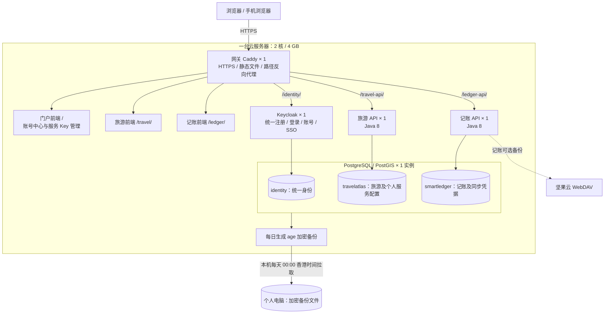

# 系统结构与部署实例

本说明根据 2026-10-28 的线上 Docker 与数据库清单核对。部署地址、真实邮箱、密码、服务 Key、私钥及备份内容不写入本文。

## 运行结构



图中的三个前端是同一个 Caddy 容器提供的三份独立静态构建产物，**不占三个 Node 服务实例**。云上没有运行 Vite 开发服务器。本机备份任务下载加密归档，不把服务器的数据覆盖进本机业务数据库，也不是实时数据库复制。

| 部署项 | 数量 | 说明 |
| --- | ---: | --- |
| 云服务器 | 1 | 当前为单机部署，没有多机容灾或负载均衡 |
| Docker 容器总数 | 5 | 网关、身份服务、旅游 API、记账 API、数据库 |
| 前端应用 | 3 | 独立源码、独立构建，共用一个静态网关 |
| 业务 API 实例 | 2 | 旅游、记账各一个，均运行 Java 8 |
| 身份服务实例 | 1 | Keycloak，使用容器内独立的 Java 运行时 |
| 数据库实例 | 1 | PostgreSQL / PostGIS，不映射公网端口 |
| 应用逻辑数据库 | 3 | identity、travelatlas、smartledger；不含系统数据库 |
| 本机备份任务 | 1 | 每天 00:00 拉取；错过计划时登录电脑后补执行 |

## 代码如何分工

```text
apps/
  portal/             门户、统一登录入口、账号中心、应用目录
  travel/             独立旅游应用
  ledger/             独立记账应用
packages/
  identity/           OIDC / SSO / 会话续期与退出
  platform/           应用注册、路径、主题、安全响应头
backend/              旅游 Java 8 后端
smartledger/backend/  记账 Java 8 后端
identity/             Keycloak 账号策略、登录主题、客户端模板
deploy/vps/           统一部署与网关配置
scripts/              构建、导出、验收、备份、Git 隐私检查
```

前端禁止从其他应用目录直接引用源码。共享能力通过 `packages` 提供。应用注册表管理入口及各应用的 API 地址。可以导出单个旅游或记账应用，在其他地址独立部署并配置自己的 OIDC 客户端；统一部署使用同一套源码。

## 统一账号与数据边界

1. 门户、旅游、记账信任同一个身份服务，账号资料和密码由身份服务统一管理。
2. 三个应用持有自己的客户端令牌。SSO 共享身份会话，各 API 仍严格校验自己所需的 audience，不能拿门户令牌直接访问业务 API。
3. 门户管理应用凭据时，先通过 SSO 取得对应应用的令牌，并核对为同一个账号。记账侧和账号中心操作的是同一份坚果云凭据。
4. 数据以身份服务与用户 subject 隔离。旅游和记账使用独立数据库及角色，不能跨库直接查询。
5. 登录令牌保存在浏览器会话存储；记账本地账本缓存使用 IndexedDB。换设备仍需从已登录账号同步，服务器备份不替代应用同步。

## 加密与备份

| 数据 | 处理方式 |
| --- | --- |
| 账号密码 | 身份服务进行口令哈希处理，业务服务不另存明文 |
| AI / 地图服务 Key | 旅游服务在服务器以 AES-256-GCM 加密，只返回掩码 |
| 坚果云邮箱和应用密码 | 记账服务加密保存，账号页与记账设置共用此记录 |
| 加密主密钥、数据库口令 | 位于服务器私有 secret 文件，通过容器挂载，不提交 Git |
| 服务器数据库归档 | age 公钥加密，本机保存恢复私钥并使用 Windows DPAPI 保护 |
| 坚果云账本备份 | 现有 JSON 备份格式，不因数据库备份加密而自动成为加密 JSON |

外网入口为网关 HTTPS；SSH 用于受控运维。两个业务容器、身份服务及数据库不直接发布公网端口。单机故障会影响整个服务，备份提供恢复能力，不提供自动故障切换。

## 账号页面与记账设置

- 账号页：桌面侧栏、手机横向导航；默认显示账号总览和应用工作台，另有资料与邮箱、安全与设备、AI/地图 Key、记账云同步四个分区。
- 个人资料仅在修改后启用保存；邮箱和密码修改仍要求身份服务再次验证。
- Key 输入不回显，保存或更换服务时清空输入；兼容参数默认折叠。
- 记账设置：统一账号入口呈现为完整卡片；接口、受众认证及请求限额放入默认折叠的详情，刷新及退出操作分开排布，移除重复账号链接。
- 三个应用使用共享的页面异常恢复组件；延迟加载显示等待状态，加载失败或渲染异常时提供重新加载和返回门户入口，不自动反复刷新。
- 账号资料与设备读取相互独立；HTTP 200 若返回 HTML 页面，不会当成有效账号数据。线上验收同时核对 Content-Type 和数据结构。

## 复核命令

```bash
# 服务器当前容器；不要用 docker inspect 打印环境变量和秘密文件内容
docker compose ps
docker ps --format '{{.Names}} {{.Ports}}'
```

```powershell
# 所有应用回归与独立边界检查
npm test
npm run check:boundaries

# 生产构建必须明确指定域名，仓库中不再硬编码实际服务器地址
node scripts/build-web.mjs --origin 'https://personal.example.com' --out-dir '.local/release/dist'

# 本地待提交内容；审计详情只写入被忽略的目录
python scripts/check-git-privacy.py --worktree --report .local/security-audit/worktree.json
```
