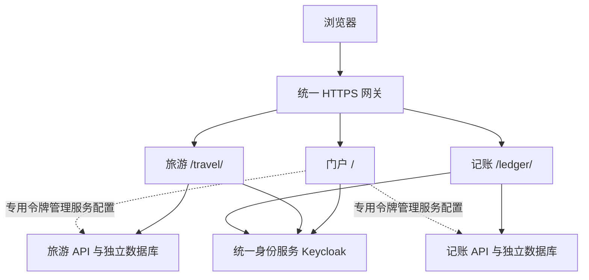

# 门户与独立应用架构（2026-10-28）

## 1. 总体结构

前端已改成 npm workspaces 单仓库，按应用分目录，各应用独立构建。门户提供应用目录、统一登录入口、账号资料和服务配置；不再导入旅游或记账的页面、状态库及业务组件。

```text
WhereToGo/
├─ apps/
│  ├─ portal/                门户、统一登录中转、账号中心、API 管理
│  ├─ travel/                旅游独立前端、页面、地图、状态库、API 客户端
│  └─ ledger/                记账独立前端、OCR、账本、流水、本地存储与同步
├─ packages/
│  ├─ identity/              OIDC 会话、续期、统一退出、Vue 账号状态与登录组件
│  └─ platform/              应用注册表、应用切换、主题变量、构建安全头
├─ backend/                  旅游 Java 8 API 与数据库迁移
├─ smartledger/backend/      记账 Java 8 API 与数据库迁移
├─ identity/                 统一身份服务及登录主题、客户端配置
├─ scripts/                  工作区构建、独立应用导出、本地启动与运维
└─ deploy/vps/               单入口 HTTPS 网关与统一服务部署
```

两个后端本来就独立，因此本次保留后端路径和数据模型；整理的是三个前端和共享平台边界。根目录 `package-lock.json` 统一锁定前端依赖，执行一次 `npm ci` 安装整个工作区。



## 2. 账号的总分关系

**账号来源只有统一身份服务。** 门户集中呈现登录、注册、资料、邮箱、密码及会话管理；子应用不另建一套密码表。各应用仍独立验证访问令牌，而不是信任一个浏览器共享的“已登录”标志。

| 部分 | OIDC client | 主要 audience | 责任 |
| --- | --- | --- | --- |
| 门户 | `portal-web` | `portal-api`、`account` | 登录与账号自助管理 |
| 旅游 | `travel-web` | `wheretogo-api` | 旅游业务与旅游个人服务配置 |
| 记账 | `smartledger-web` | `smartledger-api` | 记账业务、同步及坚果云凭证 |

门户自己的令牌不能直接访问旅游或记账 API。账号中心通过 `applicationAccess.ts` 为目标应用取得专用令牌，并检查 subject 与门户当前账号一致，再调用该应用的管理接口。该模式允许接入更多独立应用，前端不需要直接依赖其源码。

### 登录流程

1. 门户可以匿名浏览。进入子应用时，子应用先尝试静默 SSO。
2. 没有统一会话时，子应用打开门户 `/login/?app=应用标识&returnTo=应用内地址`。
3. 门户校验应用注册表与返回路径，然后通过 Keycloak 登录或注册。
4. 登录完成，门户返回被注册的子应用；子应用用自己的 client 和 PKCE 获取令牌，不把令牌放进跳转 URL。
5. iframe Cookie 被浏览器阻止时，消费一次 `__sso` 标记后进行一次顶层 `prompt=none` 授权，避免无限重登。
6. 账号资料、邮箱、密码、会话与统一退出在门户集中管理。换邮箱/密码保留重新确认身份。前端同源标签页共享非敏感退出通知；不同域名通过 IdP 会话检查与前通道退出协作。

回跳只允许注册表中对应应用的 origin 与基础路径，拒绝未知应用、外部地址、回调路径及编码路径绕过。Token 仍保存在各页面的 `sessionStorage`，不作为全站通用 JWT 广播。

`issuer + subject` 仍是已有数据归属依据。新增门户、旅游客户端不会创建新业务账号，也不迁移、清空账本或旅游数据库。旧 `wheretogo-web` 客户端在已部署服务器上保留，用于旧页面过渡。

## 3. 两种运行方式

| 配置 | 门户模式 `VITE_AUTH_MODE=portal` | 独立模式 `VITE_AUTH_MODE=standalone` |
| --- | --- | --- |
| 登录/注册入口 | 转到门户统一入口 | 当前应用直接启动 OIDC |
| 身份来源 | 同一个 Keycloak realm | 可继续使用同一个 realm |
| 账号管理入口 | 门户账号中心 | IdP 自助账号页面 |
| 是否需要门户前端在线 | 是（首次交互登录入口） | 否 |
| 业务前端/后端/数据库 | 本应用独立 | 本应用独立 |
| 跨应用业务 | 按配置连接 | 需要时配置对方应用/API 地址 |

独立部署仍应复用统一身份服务，才能保留账号互通。若主动换成另一个 realm，issuer 改变，相应的数据身份映射需要单独迁移，不能把它视为同一个账号。

独立旅游在没有记账服务时仍可管理旅游数据，旅行账本联动需要另行部署或连接记账；没有门户账号中心时，AI 服务可用后端环境配置。独立记账保留本地账本、OCR、预算和自身云同步设置。

## 4. 本地开发与统一构建

Node 24，在仓库根目录运行：

```powershell
npm ci
npm run dev:portal     # 127.0.0.1:5173
npm run dev:travel     # 127.0.0.1:5175
npm run dev:ledger     # 127.0.0.1:5174
```

完整本机服务仍使用 `scripts/start-local.ps1`。它现在生成三个应用的开发配置，并在现有本机 realm 中补建三个客户端，保留已注册用户。

统一生产前端构建：

```powershell
node scripts/build-web.mjs --origin https://你的门户域名 --out-dir .local/release/dist
```

输出 `dist/portal`、`dist/travel`、`dist/ledger` 三份静态产物，由同一个网关分别映射 `/`、`/travel/`、`/ledger/`。各自拥有 SPA 回退、基础路径和安全头；不使用门户加载子应用源码的运行方式。

完整 Java 8 服务包仍可这样构建：

```powershell
powershell -ExecutionPolicy Bypass -File deploy/vps/build-package.ps1 `
  -PublicOrigin https://你的门户域名 -OutputDirectory .local/release
```

`configure-applications.sh` 为现有 realm 补建/更新托管客户端；它保留用户、密码、其他客户端和现有业务数据。统一部署只需要一套网关、身份服务与各自独立的 API/数据库。

## 5. 单独构建或拆出代码

### 只构建一个可独立托管的记账前端

```powershell
node scripts/build-web.mjs --app ledger --standalone `
  --origin https://portal.example.com `
  --public-url https://ledger.example.com/ `
  --authority https://identity.example.com/realms/personal `
  --ledger-api https://ledger-api.example.com `
  --out-dir .local/standalone-release
```

产物在 `.local/standalone-release/ledger`，部署到记账域名根路径；旅游将 `--app` 换成 `travel`，并使用 `--travel-api` 指定旅游 API。网关需为 `/auth/*` 等应用路由提供 SPA 回退，并登记匹配的 HTTPS 回调。

### 拆成可单独维护的代码目录

```powershell
npm run export:app -- ledger D:\Application\WhereToGo\exports\ledger
npm run export:app -- travel D:\Application\WhereToGo\exports\travel
```

目标必须是新目录。导出包含所选前端、所需公共包、所选 Java 8 后端、数据库 Compose 示例及单客户端 OIDC 示例；不包含其他应用页面、本机 `.env.local`、数据库、密钥、密码、node_modules、构建产物或 Git 历史。

在导出目录执行 `npm install`，复制并填写对应应用的 `.env.example`，设置 `VITE_AUTH_MODE=standalone`、实际 HTTPS 地址、OIDC client 和 API 地址后执行 `npm run build`。导出后可独立建仓库；两种部署使用同一份应用源码。

## 6. 添加下一个应用

1. 新建 `apps/notes`，依赖公共身份包和平台注册包，使用独立 client、audience、API 与数据存储。
2. 在 `packages/platform/src/applications.ts` 注册应用，或通过门户的公开构建配置 `VITE_APPLICATIONS_JSON` 追加应用。例如：

```json
[{
  "id":"notes", "name":"Notes", "label":"笔记与知识", "title":"写下新的想法",
  "description":"独立的笔记空间", "kind":"tool", "path":"/notes/", "devPort":5176,
  "url":"https://notes.example.com/", "clientId":"notes-web", "audience":"notes-api",
  "features":["笔记","搜索"]
}]
```

3. 同一个 realm 中登记新客户端的准确回调、退出回调、允许的源和 API audience。不要给所有客户端登记通配回调。
4. 子应用调用共享身份模块；需要交互登录时通过平台的 `loginUrl()` 回到门户。新应用卡片和切换菜单由注册表生成。
5. 若门户需要代用户管理这个应用的设置，额外给该客户端登记**门户的 `/auth/silent`** 回调与门户 Web origin。门户在自己的静默回调页接收该客户端授权结果，无需把子应用页面嵌进 iframe。
6. 工作区测试/构建会发现 `apps/*/package.json` 中提供相应脚本的应用。同站点部署时还需将新应用加入发布脚本的应用配置，并给网关添加对应路径和静态产物挂载；独立域名部署则配置应用 URL 和该域名的 SPA 回退。

公开注册表只放公开地址与展示元数据，不能放密码、私钥、供应商 Key 或令牌。新应用只有明确填写 `apiUrl` 才声明 API 连接，不会误用旅游或记账接口；构建时会将配置的 HTTPS API origin 加入 CSP。不同站点的浏览器 Cookie 策略仍需要在目标浏览器验证；当前统一 HTTPS 路径部署能减少这类限制。

## 7. 边界与验收

```powershell
npm run check:boundaries  # 禁止应用跨目录导入业务源码
npm test                 # 三应用回归
node scripts/test-sso.mjs # 真实 HTTPS 协议，需进程环境中的测试账号凭据
```

本次验证还会将旅游和记账分别导出到只含一个应用的目录，独立安装依赖并构建，确认并非依赖原仓库另一应用的文件才能工作。协议测试覆盖门户登录、两个子应用静默授权、独立令牌轮换、API audience 隔离、账号中心访问和统一退出；不能将协议测试当成浏览器完整点击验收。

旧文档中的 `frontend/` 现在对应 `apps/portal/`；旅游页面和状态库在 `apps/travel/`。旧 `smartledger/frontend/` 现在对应 `apps/ledger/`，旧 `shared/identitySession.ts` 现在对应 `packages/identity/src/sessionCore.ts`。历史部署与审计文档保留原记录，新的操作以本文和当前脚本为准。

### 本次实际结果

- 门户 65 项、旅游 47 项、记账 128 项，共 240 项自动测试通过。
- 应用源码依赖边界检查通过；Java 8 完整服务包和三个前端生产构建通过。
- 旅游、记账分别在不含其他应用源码的导出目录完成安装与独立构建。
- 已部署到统一网关；26 个公开静态产物 SHA256 与本机构建一致，4 个入口/回调路由和 6 个私有路由检查通过。
- 公网真实 OIDC 检查共 10 组通过，包括门户账号中心为两个应用获取专用令牌、9 次静默切换、9 次令牌续期、统一账号资料、API 隔离及统一退出。
- 部署前完成加密数据库备份；原 API 和数据库保持运行，备份定时任务正常。浏览器连接不可用，尚未完成真实浏览器逐项点击验证。
